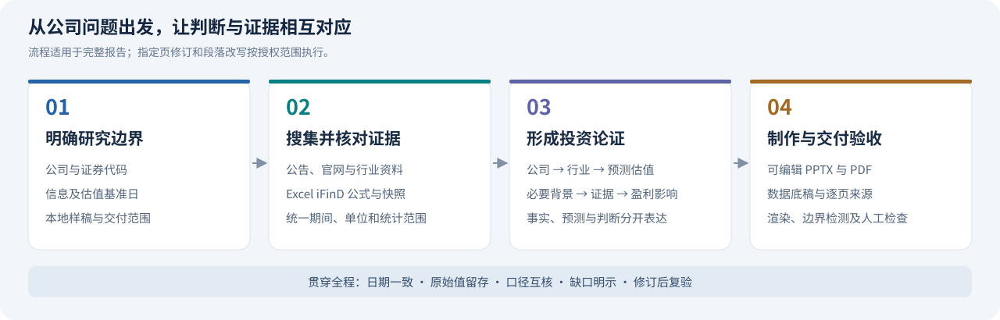

<div align="center">


# Equity Research · 上市公司深度研究

**把公开信息与数据库数据，转化为投资人读得懂、证据可追溯的研究报告。**

[能做什么](#能做什么) · [研究流程](#研究流程) · [开始使用](#开始使用) · [运行条件](#运行条件) · [文件说明](#文件说明)

</div>

## 能做什么

本项目是一套供 **Codex** 使用的研究技能。它帮助代理围绕一家公司完成资料搜集、业务与行业分析、盈利预测及估值核验，并按用户提供的本地样稿制作报告。

| 使用场景 | 你提供什么 | 技能如何处理 |
| :--- | :--- | :--- |
| **完整深度研究** | 公司、研究日期、样稿与数据条件 | 按“公司—行业—预测估值”推进，交付报告及底稿 |
| **指定页面修订** | 现有报告、修改范围与要求 | 修改指定页面，复核数据、逻辑和版式 |
| **段落改写与仿写** | 原文、参考表达与篇幅要求 | 补足背景和逻辑承接，直接交付可用正文 |

> 这套技能由代理结合当前环境执行。三个附带脚本分别辅助样稿检查、Excel 取数和报告验收；完整报告还需要代理完成分析、图表及页面制作。

## 研究流程



研究以公告、交易所、公司官网和行业官方资料为优先来源，以网页检索补充资料定位与经营变化；已有授权的本机 Excel iFinD 用于行情、财务及一致预期取数。关键数据保留原值、单位、期间、来源及计算过程。

### 写给投资人的表达方式

| 写作要求 | 实际做法 |
| :--- | :--- |
| **先交代读者需要知道的背景** | 首次出现项目、子公司或产品时，说明它是什么、与上市公司的关系及经营作用 |
| **让段落有明确主线** | 先总述，再展开业务、产品功能与客户应用；分类保持同一层级 |
| **把事实连接到投资判断** | 解释公司行动如何影响销量、价格、成本、现金流或回报，并说明兑现条件 |
| **摘要简洁，正文充分** | 摘要采用“短判断＋当前事实＋未来含义”；正文补足定义、证据和因果承接 |
| **连接词对应真实关系** | “其中”用于细分，“同时”用于并列；“因此／由此”需要有证据支持因果 |
| **区分事实与预测** | 已实现财务标 A、预测标 E；公司前瞻、机构一致预期和独立模型分别说明 |

正文写作详细规则见 [写作标准](references/writing-standards.md)。

## 开始使用

### 1. 让 Codex 读取技能

将整个 `equity-research` 文件夹放入项目的 `.agents/skills/` 下，或用户目录的 `~/.agents/skills/` 下。文件夹内须保留 `SKILL.md`，以及它引用的 `references/` 和 `scripts/`。

在支持显式调用的 Codex CLI／IDE 中，可用 `$equity-research` 选择此技能；未显示时重新启动 Codex。也可以在当前任务中明确要求读取本地 `SKILL.md`。安装位置与研究结果的输出位置彼此独立。参考 [OpenAI 技能文档](https://learn.chatgpt.com/docs/build-skills)。

### 2. 提供任务卡

```text
请使用 $equity-research，为以下公司制作完整深度报告：

公司与证券代码：[公司名称] / [代码及交易所后缀]
研究年份：[实际财务年份]、[预测年份]
信息截止日：[YYYY-MM-DD]
估值基准日：[YYYY-MM-DD]
本地样稿：[本机 PPTX 路径]
数据条件：[本机 Excel、iFinD 是否已安装并授权连接]
交付范围：可编辑 PPTX、PDF、Excel 底稿和来源清单
输出目录：G:\Codex\[公司名称]深度研究_[YYYYMMDD]
特别要求：[重点问题、篇幅或指定修改范围]
```

| 输入 | 
| :--- | 
| 公司与证券代码 | 
| 信息截止日、估值基准日 | 
| 本地样稿（本项目自带模板，如有也可以上传） | 
| 数据库与 Office 条件 | 
| 输出目录（请提供绝对路径） |


未指定信息截止日时采用用户所在地当天；默认估值基准为截止日前最近完整交易日。仅改写给定材料时保留原日期及数据口径。

### 3. 获取可复核的交付物

完整报告模式按任务和可用工具生成以下文件；局部修订、段落改写按约定范围交付。

| 交付物 | 用途 |
| :--- | :--- |
| **可编辑 PPTX** | 后续调整文字、表格、图表和页面 |
| **对应 PDF** | 阅读、审阅与确认导出结果 |
| **Excel 数据底稿** | 保存原始值、单位、口径和计算过程 |
| **原始公式与固定快照** | 复现数据库查询，保留当次实际返回结果 |
| **逐页来源清单** | 追溯事实、图表、图片和研究推导的出处 |
| **预览与验收记录** | 检查页面边界、遮挡、旧内容残留和财务互核结果 |

## 运行条件

| 能力 | 需要的环境 | 缺少条件时 |
| :--- | :--- | :--- |
| 研究与正文写作 | 可读取技能文件的代理；网页与本地文件工具 | 使用已提供材料，明确无法核实的缺口 |
| 样稿结构检查 | Python 3.9 及以上；本地 PPTX；脚本使用标准库 | 通过其他可用工具读取样稿并记录版式 |
| iFinD 自动取数 | Windows、PowerShell、桌面 Excel、已连接且有权限的 iFinD 加载项 | 输出针对证券、指标及日期的手动补取步骤，保留已完成的公开研究 |
| PPTX 渲染与边界检查 | Windows、PowerShell、桌面 PowerPoint | 在可用环境另行渲染和人工检查，不能宣称已验收 |


**数据授权：** 本项目不包含 iFinD 软件、账号或数据权限，使用本机已有授权连接。

**样稿与保密：** 仓库仅保留抽象后的结构和版式标准，默认蓝图为 26 页；实际用户提供新样稿时以新样稿为准。原始样稿、公司报告、底稿、图片和机构标识均不随技能分发。严格对照样稿制作时，需要用户在本地提供有权使用的文件。

## 文件说明

```text
equity-research/
├── README.md                         # 用途、使用方法与运行说明
├── SKILL.md                          # 技能入口与执行规则
├── assets/
│   ├── readme-hero.svg                # 独立绘制的介绍图
│   └── research-workflow.svg         # 研究流程图
├── references/
│   ├── writing-standards.md          # 投资人表达与研究写作规则
│   ├── prototype-blueprint.md        # 抽象页型及版式规范
│   └── ifind-excel.md                # Excel 公式、口径核验和手动补取
└── scripts/
    ├── inspect_prototype.py          # 读取 PPTX 结构与样式信息
    ├── query_ifind.ps1               # 执行明确的 Excel 查询清单
    └── render_and_measure.ps1        # 已有 PPTX 导出与边界检查
```

<details>
<summary><strong>辅助脚本示例：展开查看</strong></summary>

以下命令中的样稿、查询文件和报告路径均须替换为本地实际文件；输出放在 `G:\Codex` 下的项目目录。脚本参数与具体行为以脚本及引用文档为准。

**检查样稿结构**（默认不导出正文及媒体）：

```powershell
python .\scripts\inspect_prototype.py `
  --input 'G:\Codex\输入资料\样稿.pptx' `
  --output 'G:\Codex\研究项目\样稿结构.json'
```

**执行 iFinD 查询清单**（JSON 格式见 [取数说明](references/ifind-excel.md)）：

```powershell
.\scripts\query_ifind.ps1 `
  -QueryPath 'G:\Codex\研究项目\查询清单.json' `
  -OutputDir 'G:\Codex\研究项目\iFinD' `
  -TimeoutSeconds 180
```

**渲染并检查已制作的报告**：

```powershell
.\scripts\render_and_measure.ps1 `
  -ReportPath 'G:\Codex\研究项目\深度报告.pptx' `
  -OutputDir 'G:\Codex\研究项目\验收'
```

边界检测辅助发现溢出，最终仍须逐页检查图文遮挡、裁切和可读性。

</details>

---

研究结果应结合数据基准、来源缺口和假设审阅；对外发布或发送须另行获得授权。开始执行时请读取 [SKILL.md](SKILL.md)，具体行为以技能规则为准。
